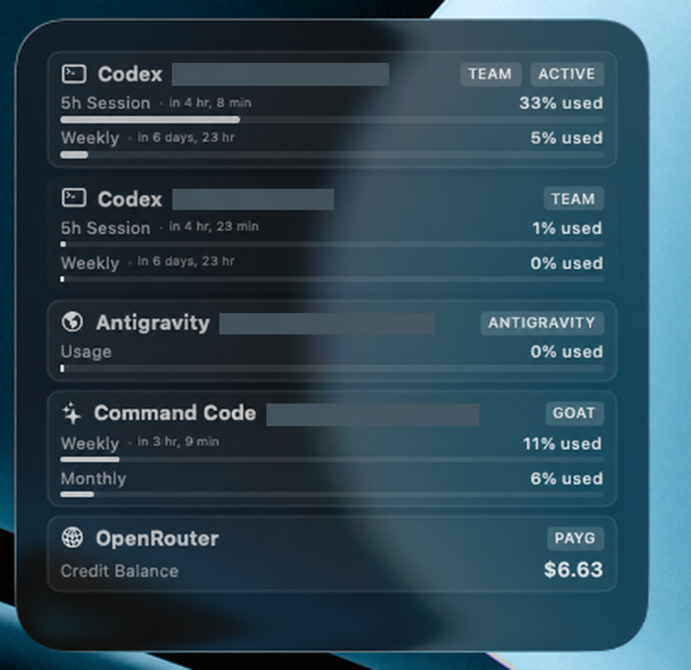
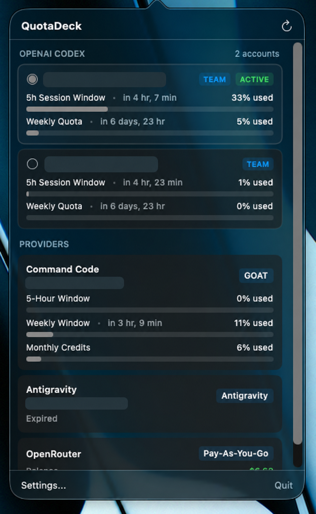
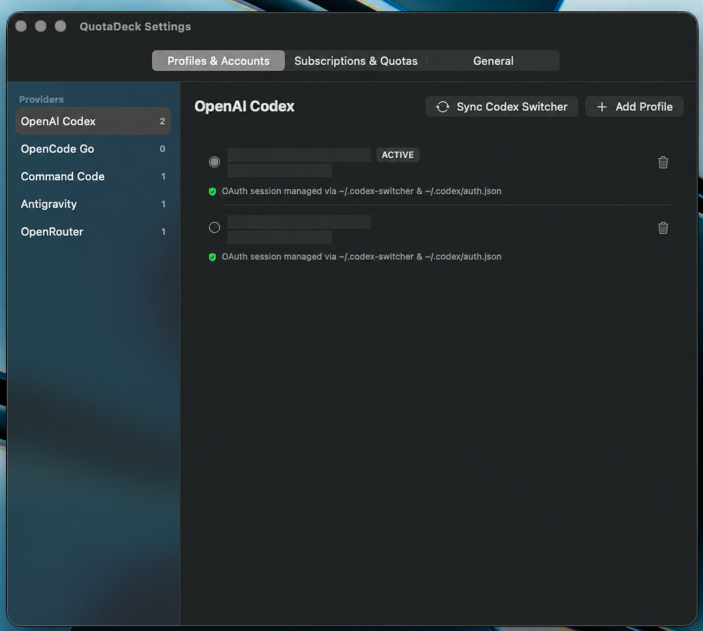
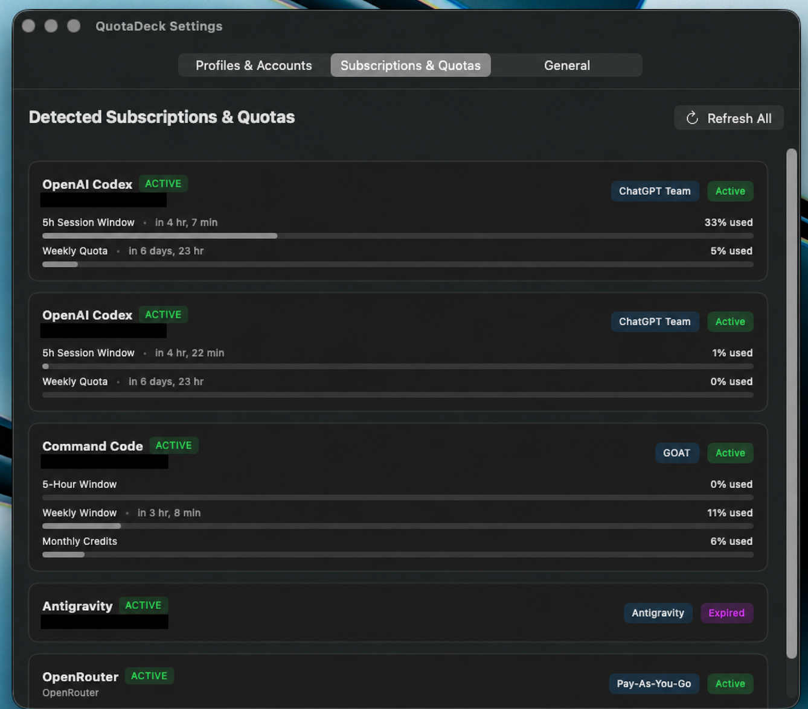
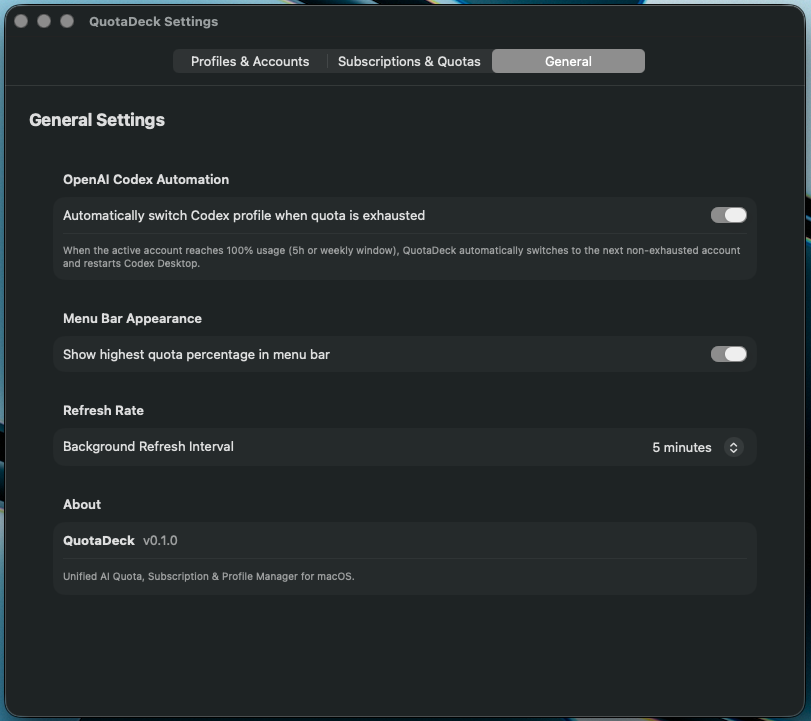

# QuotaDeck

**QuotaDeck** is a lightweight, native macOS menu bar application built with Swift, SwiftUI, and AppKit. It monitors AI provider usage, rate limits, quota reset windows, active subscriptions, and credit balances across multiple accounts, featuring one-click profile switching and automated failover for developer workflows.

---

## Features

- **Multi-Account Profile Switching**: Seamlessly manage and toggle between multiple active accounts per provider directly from the menu bar or Settings window.
- **Real-Time Quota & Limit Tracking**: Visual progress bars and countdown timers for rolling windows (5-hour, weekly, monthly) and credit balances.
- **Native macOS WidgetKit Extension**: Desktop and Notification Center circular gauges (matching macOS battery widget style) displaying live usage across providers in `systemSmall` and `systemMedium` sizes.
- **Automated Failover for OpenAI Codex**: Automatically switches to the next available account and restarts Codex Desktop when 5-hour or weekly limits are exhausted.
- **Native macOS Security**: Credentials and API keys are stored securely in macOS Keychain. No plaintext credentials in preferences or logs.
- **Zero Heavy Web Frameworks**: Pure AppKit and SwiftUI implementation with low memory and CPU footprint.

---

## Supported Providers

| Provider | Features & Metrics Monitored | Authentication / Discovery |
| :--- | :--- | :--- |
| **OpenAI Codex** | 5-hour & weekly quotas, account tiers, reset times, automated failover | Discovers profiles from `~/.codex-switcher/config.json`, live session capture from `~/.codex/auth.json`, or interactive browser login (`codex login`) |
| **Command Code** | 5-hour & weekly quotas, credit balances, automatic tier detection (including GOAT tier heuristics) | Token from `~/.commandcode/auth.json` or Keychain |
| **Antigravity** | Per-model quota percentages, internal token quotas, refresh windows | Native Keychain extraction (`gemini/antigravity`) with protobuf/base64 decoding |
| **OpenCode Go** | 5-hour, weekly, and monthly usage limits | Local CLI configuration or Keychain token |
| **OpenRouter** | Credit balances (USD), 10s request/token rate limits, usage metrics | OpenRouter API Key via Keychain |

---

## Architecture

- **`QuotaDeckCore`**: Modular Swift package containing domain models (`AccountProfile`, `SubscriptionInfo`, `QuotaWindow`), keychain credential stores, and isolated provider integrations (`CodexProvider`, `CommandCodeProvider`, `AntigravityProvider`, `OpenCodeProvider`, `OpenRouterProvider`).
- **`QuotaDeckApp`**: Native macOS menu bar application (`NSStatusItem`, `NSPopover`) and dedicated Settings window.
- **`QuotaDeckCoreTests`**: Hermetic unit tests verifying subscription parsing, quota calculations, and provider normalization without network or production Keychain access.

---

## Prerequisites

- macOS 14.0 (Sonoma) or newer
- Xcode 15.0+ or Swift 5.9+ toolchain
- XcodeGen for generating the Xcode project used to package the WidgetKit extension

---

## Building & Installation

### Build via Script
```bash
./build.sh
```
The packaged application bundle will be created at `build/QuotaDeck.app`.

### Launch the App
```bash
open build/QuotaDeck.app
```

### Running Tests
```bash
swift test
```

---

## Configuration & Usage

1. **Menu Bar Popover**:
   - Click the QuotaDeck icon in the macOS menu bar to view active accounts, remaining quota percentages, and credit balances.
   - For OpenAI Codex, click **Switch** on any account card to instantly swap active credentials in `~/.codex/auth.json` and cycle the desktop client.
2. **Settings**:
   - Click the gear icon in the popover or press `Cmd+,` while focused to open Settings.
   - **Profiles & Accounts**: Add profiles manually, initiate CLI browser logins, or sync existing profile switcher configs.
   - **Subscriptions & Quotas**: View comprehensive rate limit windows, plan tiers, and manual plan overrides.
   - **General**: Configure background polling frequency (1m, 5m, 15m, 30m), menu bar display options, and automated Codex failover.

## Screenshots

Email addresses are redacted in these screenshots.

### Widget



### Menu bar popover



### Profiles & Accounts



### Subscriptions & Quotas



### General settings



---

## License

MIT
